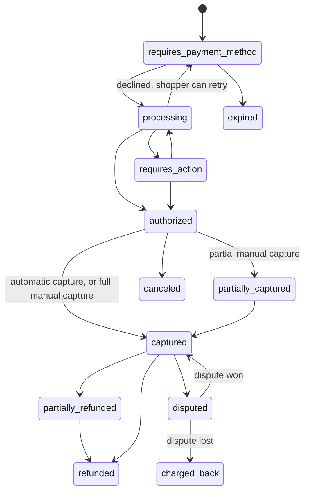

Creating a checkout session also creates its payment (`payment` field), with status
`requires_payment_method`.

| Status | Meaning |
| --- | --- |
| `requires_payment_method` | Waiting for the shopper, or the last attempt was declined |
| `processing` | An attempt is being processed |
| `requires_action` | The shopper must complete 3D Secure or a redirect |
| `authorized` | Funds reserved. With automatic capture this lasts only until the capture is confirmed |
| `partially_captured`, `captured` | Funds captured |
| `partially_refunded`, `refunded` | Money returned to the shopper |
| `canceled` | Authorisation canceled before capture |
| `expired` | The session expired without a payment |
| `disputed` | A dispute is open |
| `charged_back` | A dispute was lost |

After authorisation the status always follows the amounts (`amount_captured`,
`amount_refunded`, `amount_disputed`), so status and money can never disagree.

## Automatic and manual capture

Every session has a `capture_method`. When you omit it, Kalixo uses your account's default,
which is `automatic` unless Kalixo configured `manual` for your account. The value is echoed
on the session and the payment.

| | `automatic` | `manual` |
| --- | --- | --- |
| After the shopper pays | `authorized`, then `captured` once the payment provider confirms, usually within seconds | Stays `authorized` until you capture |
| Events | `payment.authorized` and `checkout_session.completed`, then `payment.captured` | `payment.authorized` and `checkout_session.completed`; later `payment.captured` or `payment.partially_captured` after your capture |
| `POST /v1/payments/{id}/capture` | Not allowed (`capture_not_allowed`) | Captures all or part of the amount |
| Fulfil on | `payment.captured` | `payment.authorized`, then capture when you ship |

<Note>
  With automatic capture, `payment.authorized` always comes first and `payment.captured`
  follows. Sometimes both arrive close together. Delivery order is not guaranteed, so use
  the payment's `version` and `status`, not arrival order. See
  [Delivery rules](/checkout/concepts/webhooks#delivery-rules).
</Note>

The Kalixo.js `payment.completed` browser event fires at authorisation, before the capture
is confirmed. Use it to move the shopper to your confirmation page, never to fulfil.

## Event timing

| Moment | Payment status | Events |
| --- | --- | --- |
| Session created | `requires_payment_method` | none |
| Attempt declined | `requires_payment_method` | `payment.failed` |
| Shopper must authenticate | `requires_action` | none |
| Outcome pending (for example a bank transfer) | `processing` | none until the outcome |
| Authorised | `authorized` | `payment.authorized`, `checkout_session.completed` |
| Captured (automatic or full manual) | `captured` | `payment.captured` |
| Session expired unpaid | `expired` | `payment.expired`, `checkout_session.expired` |
| Provider reported a different amount | unchanged; `amount_mismatch: true` | `payment.amount_mismatch` |

See the [event catalogue](/checkout/concepts/events) for every event type.
