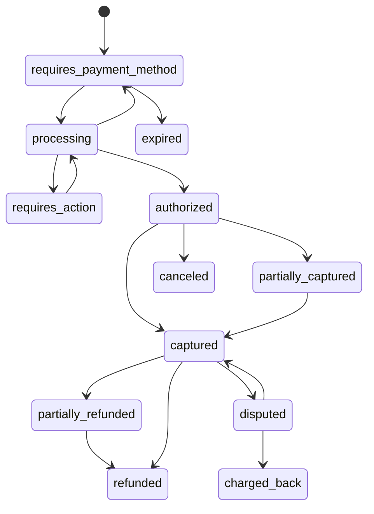

Creating a checkout session also creates its payment (`payment` field), with status
`requires_payment_method`.

| Status | Meaning |
| --- | --- |
| `requires_payment_method` | Waiting for the shopper, or the last attempt was declined |
| `processing` | An attempt is being processed |
| `requires_action` | The shopper must complete 3D Secure or a redirect |
| `authorized` | Funds reserved (manual capture) |
| `partially_captured`, `captured` | Funds captured |
| `partially_refunded`, `refunded` | Money returned to the shopper |
| `canceled` | Authorisation canceled before capture |
| `expired` | The session expired without a payment |
| `disputed` | A dispute is open |
| `charged_back` | A dispute was lost |

After authorisation the status always follows the amounts (`amount_captured`,
`amount_refunded`, `amount_disputed`), so status and money can never disagree.
