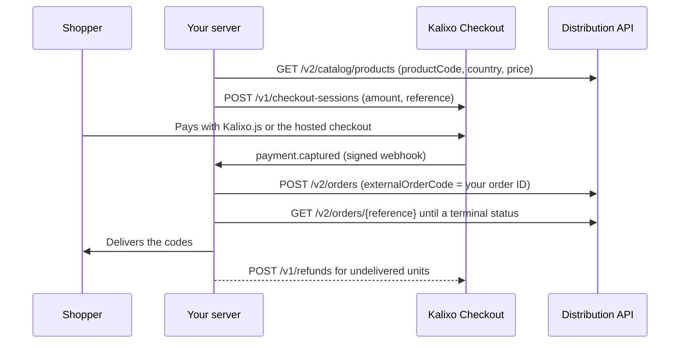

If you sell Kalixo catalog products, such as gift cards and game keys, you use both products:

- **Kalixo Checkout** takes the shopper's payment, with Kalixo as merchant of record.
- The **Distribution API** places the order for the codes and returns them.

This guide connects the two: pay, receive the webhook, order the codes, deliver them, and
refund what could not be delivered.



## Before you start

- Distribution API keys (`kal_test_…`, `kal_live_…`) and your egress IPs whitelisted. See
  [Authentication](/authentication).
- Checkout keys (`kc_sk_test_…`, `kc_pk_test_…`) and your checkout domains registered. See
  [Authentication](/checkout/authentication).
- A Checkout webhook endpoint. See [Webhooks](/checkout/concepts/webhooks).
- How Checkout payouts and Distribution orders are settled for your account (wallet or
  invoice). Your Kalixo account manager confirms this during onboarding.

The two APIs differ in a few conventions. Keep them apart in your code:

| | Distribution API | Kalixo Checkout |
| --- | --- | --- |
| Base URL | `https://api.kalixo.io/v2` | `https://checkout.kalixo.io` |
| Authentication | `x-api-key: kal_live_…` header, plus IP whitelisting | `Authorization: Bearer kc_sk_live_…` |
| Idempotency | `externalOrderCode` in the order body | `Idempotency-Key` header on every `POST` |
| Errors | `{ statusCode, error, message }` | `{ error: { type, code, message, request_id } }` |
| Request ID | `X-Request-Id` header | `Request-Id` header and `error.request_id` |
| Amounts | Integers in minor units; wallet balances in major units | Integers in minor units |
| Status updates | Poll `GET /v2/orders/{reference}` | Signed webhooks |
| SDK | [Node reference client](/examples/kalixo-node) (copy into your project) | `@kalixo/checkout-node` |

The two APIs were designed separately: the Distribution API is a server-to-server ordering
API for resellers, and Checkout follows the conventions of common payment APIs. Use a
separate client and separate keys for each.

## 1. Price the order on your server

Read the products the shopper wants from the Distribution catalog and keep, per line, the
`productCode`, the row's `countryCode`, the catalog `price` and `currencyCode`. Decide the
price you charge the shopper. It is your retail price, and it can differ from the
Distribution catalog `price`, which is what the Distribution order validates.

```javascript
const res = await fetch(
  `https://api.kalixo.io/v2/catalog/products/${productCode}?country=DE`,
  { headers: { 'x-api-key': process.env.KALIXO_API_KEY } },
);
const product = await res.json();
// { productCode: '10001000227724', countryCode: 'DE', price: 5000, currencyCode: 'EUR', ... }
```

Store an order in your database first, with its own ID (for example `order-1001`). You use
that ID as the Checkout `reference` and as the Distribution `externalOrderCode`.

## 2. Create the checkout session

Amounts are integers in the minor unit. Two EUR 50.00 cards are `10000` (EUR 100.00):

```javascript
import { KalixoCheckout } from '@kalixo/checkout-node';

const kalixo = new KalixoCheckout(process.env.KALIXO_CHECKOUT_SECRET_KEY);

const session = await kalixo.checkoutSessions.create(
  {
    amount: 10000,
    currency: 'EUR',
    country: 'DE',
    reference: 'order-1001',
    return_url: 'https://shop.example.com/checkout/complete',
    line_items: [{ name: 'PlayStation Store EUR 50', quantity: 2, unit_amount: 5000, sku: '10001000227724' }],
    metadata: { productCode: '10001000227724', distributionCountry: 'DE' },
  },
  { idempotencyKey: 'order-1001-checkout' },
);
```

Show it with [Kalixo.js](/checkout/guides/kalixo-js) or redirect to `session.url`.

## 3. Wait for `payment.captured`

Fulfil only from the webhook, never from the browser redirect. Read the payment from Kalixo
and check it against your order before you spend money on codes. See
[Fulfilment](/checkout/guides/fulfilment).

```javascript
async function onCheckoutEvent(event) {
  if (event.type !== 'payment.captured') return;
  const payment = await kalixo.payments.retrieve(event.data.object.id); // Kalixo's record decides
  const order = await db.orders.findByReference(payment.reference);
  if (!order || order.status !== 'awaiting_payment') return; // duplicate or unknown
  if (payment.status !== 'captured' || payment.amount_mismatch || payment.currency !== order.currency || payment.amount_captured !== order.amount) {
    await db.orders.flag(order.id, 'payment_check_failed');
    return;
  }
  await db.orders.update(order.id, { status: 'paid', paymentId: payment.id });
  await jobs.enqueue('place-distribution-order', { orderId: order.id });
}
```

Placing the Distribution order in a background job keeps the webhook response under
10 seconds. See [Webhooks](/checkout/concepts/webhooks).

## 4. Place the Distribution order

Use your order ID as the `externalOrderCode`. If the job runs twice, or you retry after a
timeout, Distribution returns the existing order instead of buying the codes again. See
[Idempotency](/concepts/idempotency).

```javascript
const res = await fetch('https://api.kalixo.io/v2/orders', {
  method: 'POST',
  headers: { 'x-api-key': process.env.KALIXO_API_KEY, 'Content-Type': 'application/json' },
  body: JSON.stringify({
    externalOrderCode: order.id, // 'order-1001'
    currency: 'EUR',
    orderProducts: [{ productCode: '10001000227724', country: 'DE', price: 5000, quantity: 2 }],
  }),
});
const accepted = await res.json(); // 202: { orderId, status: 'processing', estimatedReadyAt, wallet }
```

Send the catalog `price` here, not your retail price: Distribution validates it against the
catalog. Send `country` for every line; it is required for products with several markets.

If the order is rejected (`4xx`), nothing was bought: refund the shopper in full (step 6)
and fix the cause, for example a stale price or an insufficient wallet balance.

## 5. Wait for the codes and deliver them

Poll after `estimatedReadyAt` until the order reaches a terminal status. The
[Node reference client](/examples/kalixo-node) does this for you:

```javascript
import { KalixoClient } from './client.js'; // the Distribution reference client

const distribution = KalixoClient.production(process.env.KALIXO_API_KEY);
const result = await distribution.waitForOrder(accepted.orderId, accepted.estimatedReadyAt);
```

| Distribution status | What to do |
| --- | --- |
| `completed` | Deliver every code in `products[].codes` |
| `partially_completed` | Deliver the codes you received, refund the missing units, and contact [integrations@kalixo.io](mailto:integrations@kalixo.io) with the `orderId` |
| `failed` | Refund the shopper in full |

Store the codes before you show or email them, so a crash cannot lose delivered codes.

## 6. Refund what you could not deliver

Refund through Checkout, with an idempotency key derived from your order, so a retry never
refunds twice. Amounts are in the minor unit: one missing EUR 50.00 card is `5000`.

```javascript
const delivered = result.products.reduce((n, line) => n + line.codes.length, 0);
const missingUnits = 2 - delivered;

if (missingUnits > 0) {
  await kalixo.refunds.create(
    { payment: order.paymentId, amount: missingUnits * 5000, reason: 'other', metadata: { distributionOrderId: result.orderId } },
    { idempotencyKey: `order-1001-refund-undelivered` },
  );
}
```

The refund is `pending` until `refund.succeeded` arrives. See
[Captures, cancellations and refunds](/checkout/guides/captures-and-refunds).

## Test the whole flow in the sandbox

Use both sandboxes together:

1. Pay a Checkout sandbox session with the test card `4111 1111 1111 1111`.
2. On `payment.captured`, order a Kalixo Test product on the Distribution sandbox. The
   **Partial Completion** product with quantity 2 returns one code, so you can test the
   partial refund. The **Async Failure** product tests the full refund. See
   [Sandbox](/concepts/sandbox).
3. Use a Checkout amount that matches the test product: for example `998` (GBP 9.98) in
   `GBP` for two GBP 4.99 test cards.
