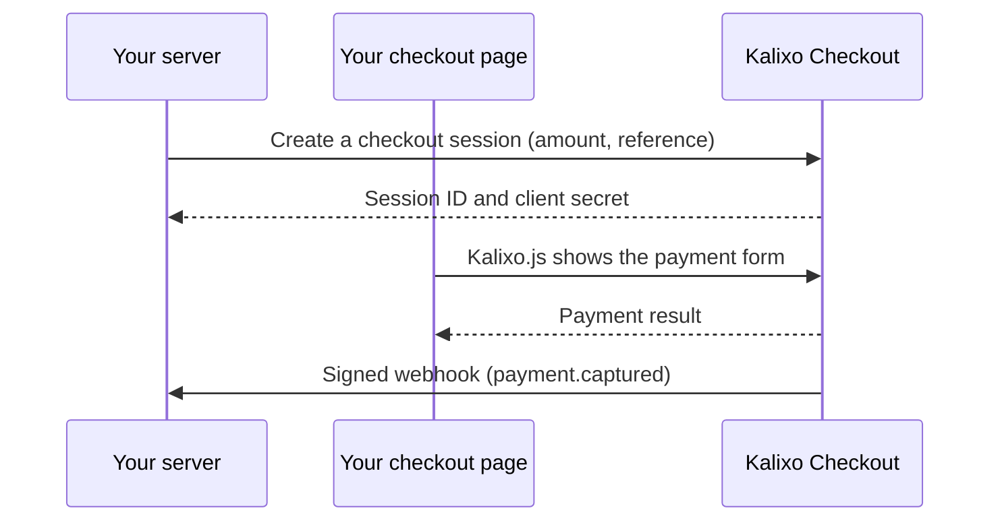

Kalixo Checkout lets you collect payments from your shoppers without integrating a
payment provider. You create a checkout session with the amount to charge, show the
checkout with **Kalixo.js** or the **hosted checkout**, and receive signed webhooks
when the payment succeeds.

Kalixo is the merchant of record. Kalixo chooses and operates the payment providers,
so provider changes never require work on your side.

<CardGroup cols={2}>
  <Card title="Quickstart" icon="rocket" href="/checkout/quickstart">
    Take a test payment in about ten minutes.
  </Card>
  <Card title="Kalixo.js" icon="code" href="/checkout/guides/kalixo-js">
    Embed the checkout in your own page.
  </Card>
  <Card title="Webhooks" icon="webhook" href="/checkout/concepts/webhooks">
    Get notified when payments, refunds and disputes change.
  </Card>
  <Card title="API reference" icon="book" href="/checkout/api-reference/introduction">
    Every endpoint, field and error.
  </Card>
</CardGroup>

## How it works

## Environments

| Environment | API | Keys |
| --- | --- | --- |
| Sandbox | `https://sandbox.checkout.kalixo.io` | `kc_sk_test_...`, `kc_pk_test_...` |
| Live | `https://checkout.kalixo.io` | `kc_sk_live_...`, `kc_pk_live_...` |

The sandbox never moves money. Build against the sandbox, then switch keys.
